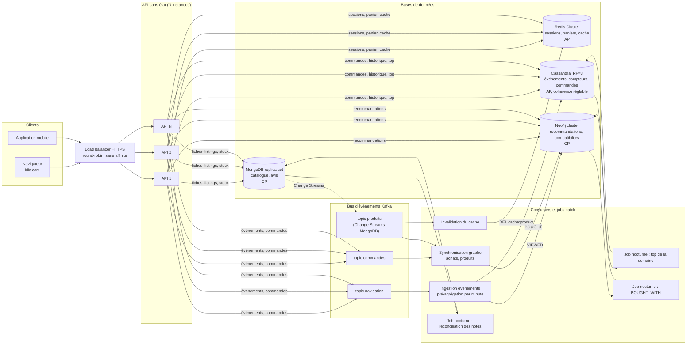
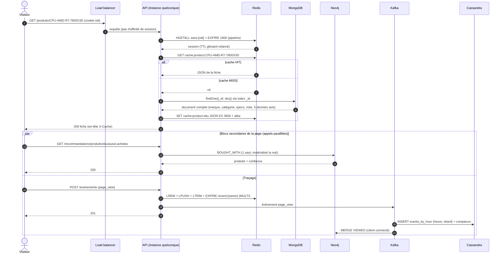
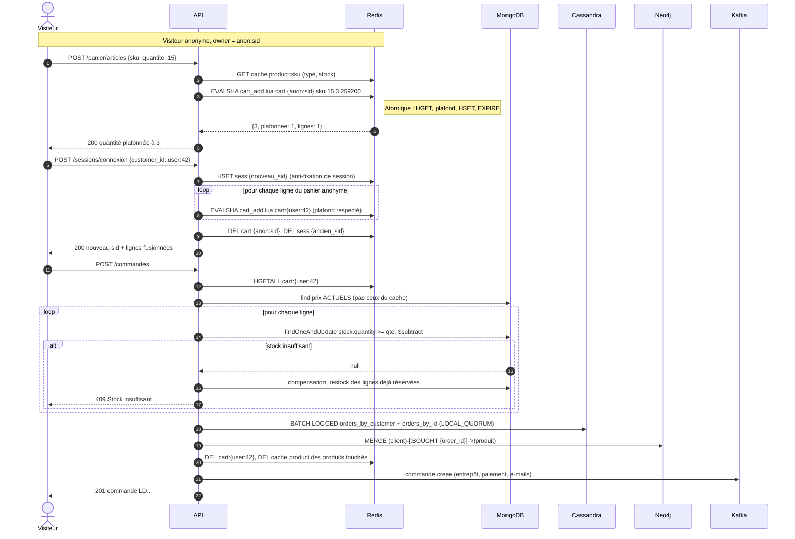

# Architecture globale — Refonte LDLC

Ce document présente l'architecture **cible** (production) et indique, quand ils diffèrent, les raccourcis pris par le prototype (`docker-compose.yml` + `api/`).

## 1. Vue d'ensemble

Persistance polyglotte : chaque besoin métier est servi par la base dont le modèle de données lui correspond. Les serveurs d'API sont **sans état** : toute donnée de session vit dans Redis, ce qui permet d'ajouter ou de retirer des serveurs pendant les pics (soldes, Black Friday) sans « sticky sessions ».

### Rôle et position CAP de chaque base

| Base | Données | Position CAP | Justification |
|------|---------|--------------|---------------|
| **MongoDB** (replica set de 3 nœuds) | Catalogue (27 000 fiches), catégories, marques, avis | **CP** | Un seul primaire accepte les écritures ; pendant une élection (quelques secondes), les écritures sont refusées plutôt que divergentes. Un prix ou un stock ne doit pas être incohérent. |
| **Redis Cluster** (3 primaires + 3 réplicas) | Sessions, paniers, historique de navigation, cache des fiches | **AP** | Réplication asynchrone : lors d'une bascule, la dernière seconde d'écritures peut être perdue, mais le service reste disponible. Acceptable pour des données éphémères et reconstructibles. |
| **Cassandra** (RF = 3, multi-nœuds) | Événements de navigation, compteurs, top hebdomadaire, historique de commandes | **AP**, cohérence **réglable** par requête | Pas de maître : un nœud en panne ne bloque rien. `ONE` pour les événements, `LOCAL_QUORUM` pour les commandes (cohérence forte puisque R + W > RF). |
| **Neo4j** (cluster, 3 primaires) | Graphe produits, clients, achats, caractéristiques | **CP** | Les écritures passent par un leader élu par consensus Raft ; les lectures peuvent aller sur des réplicas avec cohérence causale (bookmarks). |

### Flux asynchrones (cible) et prototype

| Flux | Architecture cible | Prototype |
|------|--------------------|-----------|
| Événement de navigation | API → Kafka `navigation` → consumer qui pré-agrège par minute → Cassandra (brut + compteurs) et Neo4j (`VIEWED`) | L'API écrit directement dans Cassandra, Redis et Neo4j (`services/events.py`) |
| Commande | API → MongoDB (stock) → Cassandra (`BATCH LOGGED`) → Kafka `commandes` → Neo4j, entrepôt, paiement | Écritures directes dans MongoDB, Cassandra et Neo4j (`services/orders.py`) |
| Modification d'un produit | Change Streams MongoDB → Kafka `produits` → `DEL cache:product:<sku>` + mise à jour du graphe | L'API invalide le cache et met à jour Neo4j après l'écriture (`PATCH /produits/{sku}/prix`) |
| Top de la semaine | Job Spark nocturne sur `daily_product_views` | `POST /analytics/jobs/top-semaine` (et le seed) |
| Co-achats | Job nocturne `BOUGHT_WITH` | `POST /recommandations/jobs/bought-with` (et le seed) |

Kafka découple l'API des écritures secondaires : un pic de trafic ou une base lente n'allonge pas le temps de réponse, et un message non traité est rejoué. Il n'est pas inclus dans le prototype pour garder une stack légère (8 conteneurs).

## 2. Séquence : affichage d'une fiche produit

Chemin le plus fréquent du site (millions de fois par mois) : il ne touche **que Redis** quand le cache est chaud.

Points clés :

- **une seule lecture MongoDB** en cas de MISS, grâce aux patterns Extended Reference, Subset et Computed (aucune jointure) ;
- la recommandation n'est **pas** calculée en direct : la relation `BOUGHT_WITH` est pré-calculée, ce qui donne un parcours à 1 saut, quelle que soit la popularité du produit ;
- le traçage est **asynchrone** : une panne de Cassandra ne dégrade pas l'affichage.

## 3. Séquence : du panier à la commande

Points clés :

- **pas de transaction distribuée** entre les quatre bases : la commande suit une **saga** (réservation du stock, puis compensation en cas d'échec) ;
- le décrément de stock est **atomique et conditionnel** côté MongoDB : le filtre `stock.quantity >= qte` et la mise à jour s'appliquent ensemble, donc deux clients ne peuvent pas acheter la dernière unité ;
- la commande est écrite dans **deux tables Cassandra** (une par requête) dans un `BATCH LOGGED` : les deux copies finissent toujours par être écrites toutes les deux ;
- l'écriture Neo4j est **idempotente** (`MERGE` sur `order_id`) : elle peut être rejouée sans doublon.
