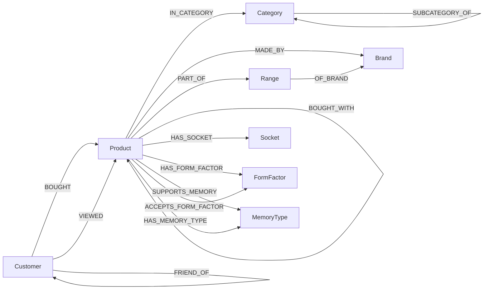

# Dossier de conception — Refonte LDLC

**OUZANIK Oualid** — projet réalisé seul

LDLC vend environ 27 000 produits high-tech de 600 marques, reçoit plusieurs millions de visites par mois et expédie jusqu'à 25 000 colis par jour. Plutôt qu'une base unique, l'architecture associe à chaque besoin la base dont le modèle de données lui correspond (persistance polyglotte). Le schéma d'ensemble et les diagrammes de séquence sont dans [architecture.md](architecture.md).

| Lot | Besoin dominant | Base | Modèle |
|-----|-----------------|------|--------|
| 1 — Catalogue | schémas variables, forte lecture | MongoDB | document |
| 2 — Panier et sessions | latence sub-milliseconde, expiration | Redis | clé-valeur en mémoire |
| 3 — Logs et commandes | écritures massives, rétention longue | Cassandra | colonnes larges |
| 4 — Recommandations | parcours de relations | Neo4j | graphe |

Les identifiants sont partagés entre les lots : SKU du catalogue (`CPU-AMD-R7-7800X3D`), clients `user:<id>`, commandes `LD<aammjj><n°>`.

---

## 1. Lot 1 — Catalogue produits (MongoDB)

### 1.1 Choix de la technologie

Un processeur se décrit par un socket et un nombre de cœurs, une souris par un DPI et un poids, une licence par une édition. Le catalogue compte des centaines de catégories aux caractéristiques disjointes, qui évoluent sans cesse.

| Alternative | Raison du rejet |
|-------------|-----------------|
| SQL, une table par catégorie | des centaines de tables, un `ALTER TABLE` à chaque nouvelle caractéristique, des recherches transverses en `UNION` |
| SQL, modèle EAV (entité-attribut-valeur) | typage perdu, une jointure par filtre, requêtes illisibles et lentes |
| PostgreSQL + JSONB | crédible, mais l'imbrication (avis, compatibles) et l'agrégation à facettes sont plus naturelles en document ; pas d'index wildcard équivalent |
| Elasticsearch comme base principale | excellent pour la recherche, mais pas une source de vérité (pas de validation de schéma, cohérence quasi temps réel) : à placer **en complément** |

MongoDB stocke chaque fiche telle qu'elle est affichée, valide les seuls champs communs (`$jsonSchema`) et indexe des champs inconnus à l'avance (index wildcard).

### 1.2 Schéma

| Collection | Contenu | Volume |
|------------|---------|--------|
| `products` | une fiche complète par SKU (`_id` = SKU) | ~27 000 |
| `reviews` | tous les avis, source de vérité | ~centaines de milliers |
| `categories` | arbre des catégories (Array of Ancestors) | ~centaines |
| `brands` | référentiel des marques | ~600 |

Document `products` (abrégé) :

```js
{ _id: "CPU-AMD-R7-7800X3D", schema_version: 2, type: "processeur",
  name: "AMD Ryzen 7 7800X3D (4.2 GHz / 5.0 GHz)",
  brand:    { _id: "amd", name: "AMD" },                                    // Extended Reference
  category: { _id: "processeurs", name: "Processeurs",
              path: ["informatique", "composants", "processeurs"] },        // Array of Ancestors
  price: { amount: Decimal128("389.95"), currency: "EUR" },
  stock: { quantity: 312, status: "en_stock" },
  specs: { socket: "AM5", cores: 8, threads: 16, cache_l3_mb: 96, tdp_w: 120 },  // Polymorphic
  compatible: [ { sku: "CM-ASUS-B650A-WIFI", name: "ASUS ROG STRIX…", type: "carte_mere" } ],
  rating: { average: 4.5, count: 8, distribution: { 1: 0, 2: 0, 3: 1, 4: 2, 5: 5 } },  // Computed
  latest_reviews: [ /* 5 avis les plus récents, allégés */ ] }                         // Subset
```

Le validateur exige `_id`, `schema_version`, `type`, `name`, `brand`, `category`, `price`, `stock` et `specs` (objet au contenu libre). `type` n'est volontairement **pas** une énumération : ajouter une catégorie ne demande ni migration ni modification du validateur. `validationLevel: "moderate"` laisse modifier d'anciens documents non conformes.

### 1.3 Embarqué ou référencé

| Donnée | Choix | Raison |
|--------|-------|--------|
| caractéristiques (`specs`) | embarquées | lues avec la fiche, propres au produit |
| marque, catégorie | référence **étendue** (`_id` + nom) | affichage sans `$lookup` ; le nom change rarement |
| produits compatibles | référence étendue (`sku`, nom, type) | **le prix n'est pas copié** : trop volatil, il est relu par `$in` |
| 5 derniers avis | embarqués (sous-ensemble) | affichés sur la fiche ; document borné |
| tous les avis | collection `reviews` | volume non borné (limite de 16 Mo par document) |

### 1.4 Patterns appliqués

| Pattern | Mise en œuvre | Bénéfice |
|---------|---------------|----------|
| **Polymorphic** | tous les types dans `products`, discriminant `type`, `specs` libre | une recherche, un listing, un panier pour tous les produits |
| **Extended Reference** | `brand`, `category`, `compatible[]` | fiche = 1 lecture ; contrepartie : propager un renommage (`updateMany` indexé) |
| **Subset** | `latest_reviews` (≤ 5) + `reviews` | document petit, working set en RAM |
| **Computed** | `rating {average, count, distribution}` mis à jour à l'écriture d'un avis | coût nul à la lecture ; moyenne recalculée depuis la distribution (pas de dérive d'arrondi) ; batch de réconciliation `$merge` |
| **Schema Versioning** | `schema_version` 1 ou 2 ; lecture compatible (`$ifNull`), migration paresseuse à la prochaine écriture | aucune migration bloquante |
| **Array of Ancestors** | `categories.ancestors[]` et `products.category.path[]` | fil d'Ariane en 1 lecture, « tous les produits de Composants » = 1 égalité indexée |

Index : `{category.path, price.amount}` (listing trié), `{specs.$**}` (wildcard), texte français pondéré (`name` 10, marque 5, description 1), `{compatible.sku}`, `{rating.average}`, `{schema_version}`, `{product_id, date}` et unicité `{product_id, author.user_id}` sur `reviews`.

### 1.5 CAP et niveaux de cohérence

Replica set de 3 nœuds : **CP**. Les réglages diffèrent selon l'usage :

| Opération | Réglage | Justification |
|-----------|---------|---------------|
| prix, stock, avis (écritures) | `w: "majority"` | survit à la perte du primaire, pas de retour arrière |
| décrément de stock | lecture et écriture sur le primaire, `findOneAndUpdate` conditionnel | aucune survente |
| listings, fiches | `readPreference: secondaryPreferred` | décharge le primaire ; quelques ms de retard sont tolérables (le cache Redis a déjà jusqu'à 1 h de retard) |
| batch de réconciliation | `readConcern: "majority"` | ne lit que des données validées |

Le prototype tourne sur un nœud unique (réglages par défaut).

### 1.6 Exemples de requêtes

```js
// Processeurs AM5 d'au moins 8 cœurs : servi par l'index wildcard (vérifié par explain())
db.products.find({ type: "processeur", "specs.socket": "AM5", "specs.cores": { $gte: 8 } })
// → AMD Ryzen 7 7800X3D

// Tous les produits sous « Composants », triés par prix (index category.path + price.amount)
db.products.find({ "category.path": "composants" }).sort({ "price.amount": 1 })
// → 12 produits, du Corsair 4000D (104,95 €) à la RTX 4070 SUPER (629,95 €)

// Nouvel avis 5★ sur le 7800X3D : pipeline de mise à jour (Subset + Computed)
// → rating.count 8 → 9, average (41/9) = 4,56, le nouvel avis passe en tête de latest_reviews
```

Côté API : `GET /produits?categorie=composants&specs.socket=AM5&specs.cores=gte:8` renvoie produits et facettes (marques, catégories, tranches de prix, disponibilité) en une agrégation `$facet`.

---

## 2. Lot 2 — Panier et sessions (Redis)

### 2.1 Choix de la technologie

| Alternative | Raison du rejet |
|-------------|-----------------|
| sessions en mémoire du serveur web + sticky sessions | perte des paniers au redémarrage, répartition de charge déséquilibrée, scalabilité horizontale bloquée |
| sessions dans MongoDB ou SQL | 1 à 5 ms par accès, purge des sessions expirées à programmer |
| Memcached | pas de structures (HASH, LIST), pas de persistance, pas de scripts atomiques |

Redis apporte la latence sub-milliseconde, l'expiration native (TTL), des structures riches manipulées côté serveur, des scripts Lua atomiques et un mode cluster.

### 2.2 Schéma des clés

| Clé | Type | Contenu | TTL |
|-----|------|---------|-----|
| `sess:{sid}` | HASH | user_id, cart_owner, csrf_token, last_seen… | 30 min **glissant** |
| `user:sessions:{user:42}` | SET | sid actifs du client (déconnexion globale) | 30 j |
| `cart:{owner}` | HASH | `sku → quantité` | 30 j (client) / 3 j (anonyme), glissant |
| `recent:{owner}` | LIST | 20 derniers SKU consultés, sans doublon | 30 j |
| `cache:product:<sku>` | STRING | JSON de la fiche | 1 h + aléa de 0 à 5 min |

`owner` vaut `user:<id>` pour un client connecté, `anon:<sid>` pour un visiteur.

### 2.3 Embarqué ou référencé

Le panier ne contient **que des références** (SKU et quantité). Prix, nom et stock sont relus au moment de l'affichage, via le cache puis MongoDB : un panier ne doit jamais afficher un prix périmé. Le prix n'est figé qu'à la création de la commande.

### 2.4 Patterns appliqués

- **TTL glissant** : chaque accès relance `EXPIRE` ; une clé expire après une durée d'*inactivité*.
- **Script Lua atomique** ([cart_add.lua](../lot2-panier-sessions-redis/cart_add.lua)) : `HGET`, plafond (10 par article, 3 pour une carte graphique), `HSET` et `EXPIRE`, sans entrelacement possible entre deux onglets ou deux serveurs. Il contrôle aussi ses paramètres et limite le panier à 100 lignes.
- **Hash tags** : `cart:{user:42}` et `recent:{user:42}` sont sur le même slot, donc utilisables dans une même transaction `MULTI` ou un même script. À l'inverse, `cache:product:<sku>` n'a pas de hash tag, pour se répartir sur tout le cluster.
- **Cache-aside** avec invalidation à l'écriture et aléa sur le TTL (pas d'expiration simultanée) ; un verrou `SET … NX PX` évite qu'un produit très demandé soit reconstruit par tous les serveurs à la fois.
- **Fusion du panier à la connexion** : `cart:{anon:…}` et `cart:{user:…}` n'ont pas le même hash tag, donc la fusion est faite ligne par ligne par l'application, via le script Lua (plafonds respectés), puis le panier anonyme est supprimé. Le sid est régénéré (protection contre la fixation de session).

### 2.5 CAP et niveaux de cohérence

Redis Cluster est **AP** : la réplication vers les réplicas est asynchrone, et une bascule peut perdre les dernières écritures. Atténuations :

- persistance AOF `appendfsync everysec` : au plus une seconde perdue en cas de crash ;
- (cible) `WAIT 1 100` après une écriture critique (fusion de panier), pour attendre l'accusé d'au moins un réplica ;
- (cible) deux instances aux politiques différentes : sessions et paniers en `noeviction` (jamais d'éviction d'un panier), cache en `allkeys-lru` sans persistance (reconstructible depuis MongoDB).

Dimensionnement : environ 25 Mo de sessions, 90 Mo de paniers et 55 Mo de cache. Le cluster sert la disponibilité et le débit, pas la capacité.

### 2.6 Exemples

```
EVALSHA <sha> 1 cart:{user:42} GPU-ASUS-RTX4070S-12 15 3 2592000
→ 1) 3   2) 1   3) 3        (15 demandées, plafonnées à 3, panier de 3 lignes)

MULTI / LREM recent:{user:42} 0 CPU-… / LPUSH … / LTRIM … 0 19 / EXPIRE … / EXEC
```

Prototype : la première requête `GET /produits/{sku}` renvoie `X-Cache: MISS`, la suivante `HIT`. Après `PATCH /produits/{sku}/prix`, la fiche repasse en `MISS`.

---

## 3. Lot 3 — Logs de navigation et commandes (Cassandra)

### 3.1 Choix de la technologie

Environ 5 millions d'événements par jour en moyenne, avec des pics de 2 millions par heure au Black Friday ; conservation sur des mois (événements) et 10 ans (commandes).

| Alternative | Raison du rejet |
|-------------|-----------------|
| PostgreSQL partitionné | un seul nœud d'écriture : plafond de débit, scalabilité verticale |
| MongoDB (collections time series) | primaire unique par shard, purge moins efficace que la compaction par fenêtres de temps |
| Elasticsearch / ELK | adapté à la recherche dans les logs, coûteux en stockage sur plusieurs années, pas fait pour l'historique de commandes |
| ClickHouse ou Druid | excellents pour l'OLAP ad hoc, à envisager **en complément** ; pas de requêtes clé-valeur rapides pour « mes commandes » |

Cassandra écrit en *append-only* sans lecture préalable, monte en charge linéairement en ajoutant des nœuds, n'a pas de maître, et gère nativement le TTL et la compaction par fenêtres de temps.

### 3.2 Schéma : une table par requête

| Requête | Table | Clé de partition | Colonnes de tri |
|---------|-------|------------------|-----------------|
| relire les événements d'une heure | `events_by_hour` | `(bucket_hour, shard)` | `event_id` timeuuid DESC |
| vues d'un produit aujourd'hui / sur N jours | `product_views_by_day` (COUNTER) | `sku` | `day` DESC |
| vues de tous les produits d'un jour | `daily_product_views` (COUNTER) | `(day, shard)` | `sku` |
| statistiques du site par jour | `daily_site_stats` (COUNTER) | `day` | `event_type` |
| top de la semaine | `top_products_by_week` | `(week, category_id)` | `rank` ASC |
| historique de commandes d'un client | `orders_by_customer` | `customer_id` | `order_date` DESC, `order_id` |
| détail d'une commande | `orders_by_id` | `order_id` | — |

**Dimensionnement des partitions** (cible : moins de 100 Mo et moins de 100 000 lignes, sans partition chaude) :

- `events_by_hour` : le seau d'une heure borne la taille de la partition ; 16 shards (`crc32(session_id) % 16`) répartissent les écritures sur tout l'anneau. Une heure normale donne 31 000 lignes, soit environ 12 Mo par partition ; le Black Friday environ 50 Mo. Lire une heure revient à 16 lectures lancées en parallèle.
- `product_views_by_day` : 365 lignes par an et par produit, environ 18 Ko.
- `daily_product_views` : partitionner par le seul jour créerait une partition chaude (toutes les vues du site sur 3 nœuds), d'où 8 shards, soit environ 3 400 lignes par partition.
- `orders_by_customer` : quelques Ko pour un particulier, environ 4 Mo pour un compte professionnel de 2 000 commandes. Pour de très gros comptes B2B, on ajouterait l'année à la clé de partition.

### 3.3 Embarqué ou dénormalisé

Pas de jointure : les lignes de commande sont **embarquées** sous forme de `list<frozen<order_line>>` (UDT : SKU, nom, prix unitaire, quantité, total). C'est une photo **figée** au moment de l'achat : la facture ne doit pas changer si le prix du catalogue change. La commande est **dupliquée** dans `orders_by_customer` et `orders_by_id`, et le top hebdomadaire copie nom et marque pour éviter un appel au catalogue.

### 3.4 Patterns appliqués

- **Query-driven design** : une table par requête, chaque lecture touche une seule partition. La requête « toutes les vues du produit X » sur les événements bruts exigerait `ALLOW FILTERING`, donc un parcours de tout le cluster : d'où les tables de compteurs dédiées.
- **Bucketing temporel + sharding** de la clé de partition (`events_by_hour`, `daily_product_views`).
- **Clustering timeuuid** : unicité garantie (deux événements à la même milliseconde ne s'écrasent pas) et tranches de temps via `minTimeuuid` / `maxTimeuuid`.
- **TTL + TimeWindowCompactionStrategy** : 13 mois sur les événements bruts (durée recommandée par la CNIL pour la mesure d'audience). Une journée entière expirée est supprimée en bloc, sans tombstones ; aucun `DELETE` sur cette table, et `gc_grace_seconds` est réduit à 3 h. Les agrégats anonymes sont conservés sans limite.
- **Compteurs pré-agrégés** : le consumer cumule par minute (`+37` au lieu de 37 × `+1`). Les compteurs ne sont pas idempotents (un retry peut compter deux fois), ce qui est acceptable pour des statistiques ; les chiffres exacts restent recalculables depuis les événements bruts.
- **Pré-calcul** : Cassandra ne trie pas par valeur de compteur. Le top est calculé par un job (7 jours × 8 shards = 56 lectures de partition), puis écrit déjà trié.
- **LeveledCompactionStrategy** sur les commandes, lues souvent et mises à jour (changement de statut).

### 3.5 CAP et niveaux de cohérence

Cassandra est **AP**, avec une cohérence réglée requête par requête (RF = 3) :

| Données | Écriture | Lecture | Effet |
|---------|----------|---------|-------|
| événements, compteurs | `ONE` | `ONE` | débit maximal ; une perte infime est sans conséquence |
| top hebdomadaire | `LOCAL_QUORUM` | `ONE` | écrit une fois par nuit, lu très souvent |
| commandes | `LOCAL_QUORUM` | `LOCAL_QUORUM` | R + W = 4 > RF = 3 : on relit toujours sa propre commande |

Le changement de statut met à jour les deux tables dans un **`BATCH LOGGED`** : atomicité (les deux écritures finiront par être appliquées), mais pas d'isolation. C'est le bon usage d'un batch : la cohérence entre tables dénormalisées, pas la performance. Le prototype utilise `LOCAL_ONE` partout (un seul nœud).

### 3.6 Exemples

```sql
SELECT views FROM product_views_by_day WHERE sku = 'CPU-AMD-R7-7800X3D' AND day = '2026-11-18';
-- → 1841 (une partition, une ligne)

SELECT rank, sku, views FROM top_products_by_week WHERE week = '2026-W47' AND category_id = 'all' LIMIT 10;
-- → 1 GPU-ASUS-RTX4070S-12 21480 | 2 CPU-AMD-R7-7800X3D 14790 | 3 RAM-CORSAIR-DDR5-32-6000 9935

SELECT order_date, order_id, status, total_amount FROM orders_by_customer WHERE customer_id = 'user:42' LIMIT 20;
-- page suivante : … AND order_date < <date de la dernière commande affichée>
```

---

## 4. Lot 4 — Recommandations et compatibilités (Neo4j)

### 4.1 Choix de la technologie

Les questions portent sur des **relations** : « les clients qui ont acheté ce processeur ont aussi acheté… » (2 sauts), « produits compatibles avec ce boîtier » (2 à 4 sauts), amis d'amis.

| Alternative | Raison du rejet |
|-------------|-----------------|
| SQL | une jointure, souvent une auto-jointure, par saut ; le coût croît avec la taille des tables |
| MongoDB `$graphLookup` | possible sur un arbre simple, mais lent et peu lisible pour des motifs à plusieurs types de relations |
| liste `compatible[]` saisie à la main | N × M relations à maintenir ; un nouveau produit n'est compatible avec rien tant qu'on ne l'a pas saisi |
| moteur de ML (factorisation, embeddings) | complémentaire à grande échelle, mais opaque (« pourquoi ce produit ? ») et sans logique de compatibilité |

Dans Neo4j, une relation est un pointeur physique entre deux nœuds (*index-free adjacency*) : le coût d'un parcours dépend du nombre de voisins visités, pas de la taille totale du graphe.

### 4.2 Schéma



```
(:Product)-[:IN_CATEGORY]->(:Category)-[:SUBCATEGORY_OF]->(:Category)
(:Product)-[:MADE_BY]->(:Brand)      (:Product)-[:PART_OF]->(:Range)-[:OF_BRAND]->(:Brand)
(:Customer)-[:BOUGHT {order_id, date, quantity, unit_price}]->(:Product)
(:Customer)-[:VIEWED {count, last_seen}]->(:Product)
(:Customer)-[:FRIEND_OF]->(:Customer)
(:Product)-[:BOUGHT_WITH {customers, confidence}]->(:Product)          ← matérialisé la nuit
(:Product)-[:HAS_SOCKET]->(:Socket)            (:Product)-[:HAS_FORM_FACTOR]->(:FormFactor)
(:Product)-[:SUPPORTS_MEMORY]->(:MemoryType)   (:Product)-[:ACCEPTS_FORM_FACTOR]->(:FormFactor)
(:Product)-[:HAS_MEMORY_TYPE]->(:MemoryType)
```

Contraintes d'unicité sur `Product.sku`, `Category.id`, `Brand.id`, `Range.id`, `Customer.id`, `Socket.name`, `FormFactor.name` et `MemoryType.name` (elles créent aussi l'index du point d'entrée) ; index sur `Product.type`, `Product.price` et `BOUGHT.order_id`.

### 4.3 Embarqué ou référencé

Dans un graphe, les références **sont** les relations. Le graphe ne contient que ce qui sert aux parcours (SKU, nom, type, prix, quelques propriétés comme `length_mm` et `max_gpu_length_mm`) ; la fiche complète reste dans MongoDB. Les caractéristiques partagées sont des **nœuds** et non des propriétés : c'est ce qui rend la compatibilité *déductible*. Un nouveau CPU relié au nœud `Socket {name: "AM5"}` devient immédiatement compatible avec toutes les cartes mères AM5.

### 4.4 Patterns appliqués

- **Compatibilité dérivée par parcours** : CPU → Socket ← carte mère ; carte mère → MemoryType ← RAM ; carte mère → FormFactor ← boîtier ; carte graphique ↔ boîtier par comparaison de propriétés (longueur).
- **Matérialisation nocturne** (`BOUGHT_WITH`) : en direct, le parcours à 2 sauts d'un produit populaire visite des millions de chemins (supernœud). Le job écrit la relation orientée avec `confidence = P(B | A)` (asymétrique, d'où l'orientation) et un `run_id`, puis supprime les relations non recalculées : le site n'est jamais sans recommandations pendant le job.
- **Score multicritère** (recommandations personnalisées) : co-acheteurs + 0,5 × vues + 2 × achats d'amis + 3 × compatibilité avec le matériel déjà acheté, en excluant les catégories déjà achetées (on ne repropose pas un 2e processeur). Pour un client sans historique, on se rabat sur les produits les plus achetés (démarrage à froid).

### 4.5 CAP et niveaux de cohérence

Cluster Neo4j : **CP**. Les écritures passent par un leader élu par consensus Raft et sont validées par une majorité ; les lectures peuvent aller sur des réplicas secondaires. La **cohérence causale** (bookmarks transmis par le driver) garantit qu'un client relit ses propres écritures. Le graphe est une **vue dérivée** (achats issus de Cassandra, produits issus de MongoDB) : un léger retard est acceptable, et il peut être reconstruit entièrement.

### 4.6 Exemples (résultats sur le jeu d'essai)

```cypher
// Cartes mères achetées par les acheteurs du 7800X3D
MATCH (p:Product {sku: $sku})<-[:BOUGHT]-(c)-[:BOUGHT]->(mb)-[:IN_CATEGORY]->(:Category {id: 'cartes-meres'})
RETURN mb.name, count(DISTINCT c) AS clients
// → ASUS ROG STRIX B650-A : 4 clients sur 6 (confiance 0,67) | MSI PRO B650M-A : 1 (0,17)

// Compatibles avec le boîtier Fractal North
// → cartes mères ATX et Micro-ATX ; RTX 4070 SUPER (267 mm ≤ 355 mm) ; CPU AM5 et LGA1700 via une carte mère

// Recommandations pour user:42 (a acheté un 7800X3D, regarde une RTX 4070 SUPER)
// → B650-A (score 12,5) > Vengeance DDR5 (11,0) > RTX 4070 SUPER (6,5)
```

Configurateur (`GET /recommandations/configurateur?cpu=CPU-AMD-R7-7800X3D`) : propose des configurations CPU → carte mère → RAM + boîtier (+ la carte graphique la plus achetée qui rentre dans le boîtier), classées par popularité puis par prix total.

---

## 5. Cohérence entre les bases

Il n'existe pas de transaction distribuée entre MongoDB, Redis, Cassandra et Neo4j, et on n'en veut pas : un commit à deux phases sur quatre systèmes ruinerait la disponibilité. La cohérence repose sur quatre principes.

**1. Une source de vérité par donnée** ; toutes les autres copies sont des vues dérivées, reconstructibles.

| Donnée | Source de vérité | Copies dérivées |
|--------|------------------|-----------------|
| fiche produit, prix, stock | MongoDB `products` | `cache:product:*` (Redis), nœuds `Product` (Neo4j), noms dans `top_products_by_week` |
| avis | MongoDB `reviews` | `latest_reviews` et `rating` dans `products` |
| panier, session | Redis | — (éphémère) |
| commande | Cassandra `orders_by_id` | `orders_by_customer`, relations `BOUGHT` (Neo4j) |
| événements | Cassandra `events_by_hour` | compteurs, top, relations `VIEWED` |
| co-achats | relations `BOUGHT` | `BOUGHT_WITH` |

**2. Des mécanismes de propagation adaptés au retard toléré**

| Mécanisme | Où | Retard toléré |
|-----------|----|---------------|
| invalidation du cache (`DEL`) après écriture, via Change Streams → Kafka en cible | prix, stock → Redis | quelques ms ; borné à 1 h par le TTL si l'invalidation est perdue |
| saga avec compensation | commande : stock MongoDB → Cassandra → Neo4j | aucun pour le stock (décrément conditionnel atomique) |
| `BATCH LOGGED` | deux tables de commandes | aucun : atomicité garantie |
| consumer Kafka | événements → compteurs, `VIEWED` ; commandes → `BOUGHT` | secondes |
| jobs nocturnes | top, `BOUGHT_WITH`, réconciliation des notes | 24 h |

**3. Idempotence des écritures rejouables.** `MERGE … {order_id}` dans Neo4j, *upserts* naturels de Cassandra (même clé primaire = écrasement), migration v1 → v2 conditionnée sur `schema_version: 1`. Exception assumée : les compteurs Cassandra.

**4. Réconciliation périodique.** Le batch `$merge` recalcule les notes depuis `reviews`, le job `BOUGHT_WITH` réécrit tout le graphe de co-achats, et le top hebdomadaire est réécrit chaque nuit. Une mise à jour secondaire perdue est donc corrigée au pire en 24 h.

**Scénarios de panne :**

| Panne | Conséquence | Traitement |
|-------|-------------|------------|
| plus de stock pendant la commande | 409 | les lignes déjà réservées sont restockées (compensation) |
| Cassandra indisponible après la réservation du stock | commande non écrite | compensation du stock, erreur renvoyée ; en cible, *outbox* dans MongoDB rejouée vers Kafka |
| Neo4j indisponible | `BOUGHT` manquant | rejoué depuis Kafka (cible) ; à défaut, resynchronisation depuis Cassandra par un job |
| invalidation du cache perdue | ancien prix affiché ≤ 1 h | le prix facturé est relu dans MongoDB à la commande, jamais dans le cache |
| bascule Redis | ≤ 1 s de paniers perdus | `WAIT` sur les écritures critiques ; impact limité à quelques paniers |

**Prototype vs cible.** Le prototype écrit directement dans les quatre bases depuis l'API (pas de Kafka, pas d'*outbox*). Il implémente le décrément conditionnel, la compensation, le `BATCH LOGGED`, le `MERGE` idempotent, l'invalidation du cache et les deux jobs ; le seed recopie les commandes du graphe vers Cassandra pour que les deux bases partent du même état.

## 6. Limites et pistes

- **Recherche** : l'index texte de MongoDB ne gère ni les fautes de frappe ni la pertinence fine ; en production, Atlas Search ou Elasticsearch, alimenté par les Change Streams.
- **Analytics ad hoc** : Cassandra ne répond qu'aux requêtes prévues. Pour l'exploration libre, il faudrait exporter vers ClickHouse ou un data lake.
- **Paiement et stock entrepôt** : hors périmètre ; le stock de MongoDB est le stock *vendable*.
- **Sécurité** : le prototype simule la connexion (pas de mot de passe) et n'active pas l'authentification sur MongoDB, Redis et Cassandra.
